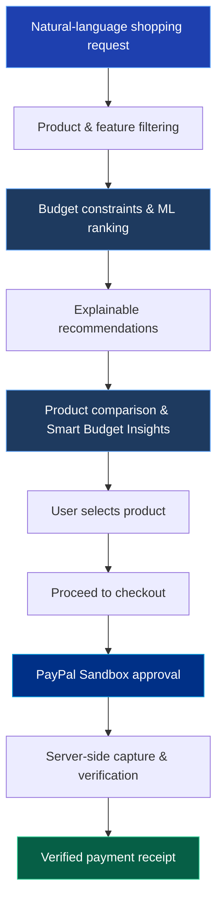

# SmartPay AI — Explainable Agentic Checkout

**Smarter decisions. Safer checkout.**

An intelligent shopping copilot that combines machine learning, explainable financial decision support, and human-approved PayPal Sandbox payments.

Developed for the **PayPal AI Hackathon 2026**.

## Project demonstration

[Watch the SmartPay AI demo on YouTube](https://www.youtube.com/watch?v=4iD8FdjjoAI)

The 1-minute 27-second demonstration showcases the complete shopping journey: natural-language product discovery, relevant AI recommendations, budget guardrails, side-by-side comparison, explainable financial insights, product selection, PayPal Sandbox checkout, and a verified payment receipt.

## Overview

SmartPay AI transforms a natural-language shopping request into relevant, explainable and budget-aware product recommendations.

Instead of simply recommending products, the application helps users understand the financial impact of a purchase, compare alternatives, and make an informed decision before proceeding to checkout.

The user remains in control throughout the entire process. Selecting a product updates the decision-support tools without automatically starting checkout. Payment is initiated only when the user explicitly proceeds to checkout and authorises the transaction through PayPal.

> All catalogue products and prices are fictional. This is a local proof of concept, not a merchant website, investment product, fraud-detection service, or source of financial advice. **Only PayPal Sandbox is supported. No real money is used.**

Product illustrations are original SVG artwork created for the fictional catalogue. No real product imagery or live shop links are used.

## Key features

### AI-powered product discovery

- Natural-language shopping requests in English and Spanish.
- Local machine learning recommendation engine using character n-gram TF-IDF similarity.
- Product-type and feature-specific filtering, including active noise cancellation (ANC).
- Relevance-first ranking, with affordability as a secondary ranking signal.
- Unsupported requests return no recommendations rather than unrelated products.
- Optional language-model explanations through an OpenAI-compatible API.

### Explainable decision support

- Side-by-side comparison of recommended products.
- Comparison of catalogue features, prices, ranking scores, budget consumption and remaining funds.
- Visual identification of the top-ranked recommendation and the currently selected product.
- Users can switch between products before proceeding to checkout.
- Ranking scores represent recommendation relevance, not independently measured product quality.

### Smart Budget Insights

- User-defined maximum purchase amount and available monthly discretionary funds.
- Convenient budget controls with €10 increments.
- Server-side enforcement of both spending limits.
- Estimated remaining funds after the selected purchase.
- Percentage of available funds consumed by the purchase.
- Price differences between eligible alternatives.
- Budget insights update when the user selects a different product.

Budget calculations are based on user-provided figures. They do not represent bank balances, credit assessments or professional financial advice.

### Human-in-the-loop checkout

- Product selection is independent of payment initiation.
- Users can explore, compare and change their selection without leaving the decision-support interface.
- The **Proceed to checkout** action takes the user to the PayPal payment section.
- The user separately authorises the transaction through the official PayPal Checkout interface.
- Cancelled payments allow the user to return to the shopping experience.

### PayPal Sandbox integration

- OAuth authentication using server-side PayPal credentials.
- Official PayPal Orders v2 API.
- Server-side order creation using authoritative catalogue prices in EUR.
- PayPal JavaScript SDK checkout buttons.
- Server-side payment capture and session-order association.
- Verification of completed captures and payment amounts before displaying a successful receipt.
- Sandbox-only API configuration to prevent accidental live payments.

### Verified payment receipt

After a successful PayPal Sandbox capture, the application displays:

- Purchased product.
- Total amount paid.
- Estimated remaining funds after purchase.
- PayPal Order ID.
- PayPal Capture ID.
- Confirmed payment status.

Pending, cancelled or mismatched captures do not produce a successful payment receipt.

Receipts are stored in ephemeral application sessions. The prototype does not maintain a persistent spending ledger or connect to real bank accounts.

## Application workflow




## Technology stack

| Component | Technology |
| --- | --- |
| Backend | Python, FastAPI |
| Application server | Uvicorn |
| Machine learning | scikit-learn, TF-IDF |
| Frontend | HTML, CSS, JavaScript |
| Product illustrations | SVG |
| HTTP client | HTTPX |
| Payment integration | PayPal Orders v2 REST API |
| Checkout | PayPal JavaScript SDK |
| Optional AI reasoning | OpenAI-compatible API |
| Testing | pytest |
| Version control | Git, GitHub |

The default recommendation engine runs locally without requiring an external AI API key.

## Installation and quick start

### Requirements

- Python 3.10 or later recommended.
- Git.
- A modern web browser.
- Internet access for PayPal Sandbox checkout.
- PayPal Sandbox credentials for payment testing.

### Clone the repository

```bash
git clone https://github.com/Julen396/smartpay-ai.git
cd smartpay-ai
```

### Windows PowerShell

Create a virtual environment and install dependencies:

```powershell
python -m venv .venv
.\.venv\Scripts\python.exe -m pip install -r requirements.txt
```

Create a local configuration file:

```powershell
Copy-Item .env.example .env
```

Start the application:

```powershell
.\.venv\Scripts\python.exe -m uvicorn app:app
```

### Linux / macOS

```bash
python3 -m venv .venv
source .venv/bin/activate
pip install -r requirements.txt
cp .env.example .env
python -m uvicorn app:app
```

### Open the application

Visit:

http://127.0.0.1:8000

The recommendation engine works without PayPal credentials or an external LLM API key.

## Example shopping requests

| Shopping request | Maximum purchase |
| --- | --- |
| I need noise-cancelling headphones for work. | €100 |
| I need comfortable headphones for travel. | €100 |
| I need an external SSD for backups. | €120 |
| I need a mechanical gaming keyboard. | €100 |

For a complete demonstration, try the following:

1. Enter `I need noise-cancelling headphones for work`.
2. Set the maximum purchase amount to €100 and available monthly funds to €180.
3. Analyse the request and compare the recommended ANC headphones.
4. Select different products to observe how Smart Budget Insights changes.
5. Reduce the maximum purchase amount to €60 and analyse the request again.
6. Select an eligible product and proceed to checkout.
7. Complete a PayPal Sandbox payment and inspect the verified receipt.

## Configure PayPal Sandbox

### 1. Create a Sandbox application

Visit the [PayPal Developer Dashboard](https://developer.paypal.com/dashboard/applications/sandbox).

Create or open a Sandbox REST application and obtain its Client ID and Client Secret.

### 2. Configure local credentials

Open the local `.env` file and set:

```dotenv
PAYPAL_CLIENT_ID=your_sandbox_client_id
PAYPAL_CLIENT_SECRET=your_sandbox_client_secret
```

Never commit the `.env` file or expose the Client Secret in frontend code.

The repository includes `.env.example` as a configuration template. The real `.env` file is excluded through `.gitignore`.

### 3. Start the application

Restart the application after saving the configuration.

### 4. Complete a test payment

1. Search for a product and review the available recommendations.
2. Select a product and review its budget impact.
3. Click **Proceed to checkout**.
4. Click the PayPal checkout button.
5. Authenticate using a Sandbox Personal buyer test account.
6. Approve the fictitious payment.
7. Review the verified payment receipt displayed by SmartPay AI.

Sandbox buyer accounts can be managed through:

[PayPal Sandbox Accounts](https://developer.paypal.com/dashboard/accounts)

The PayPal REST API base is restricted to:

```text
https://api-m.sandbox.paypal.com
```

**Do not use live credentials or a real consumer payment account in this prototype.**

## Optional LLM integration

The default recommendation engine and deterministic explanations work without an external language model.

To enable additional natural-language explanations, configure the following variables in `.env`:

```dotenv
OPENAI_API_KEY=your_api_key_here
OPENAI_MODEL=gpt-4.1-mini
```

For other OpenAI-compatible providers, configure `OPENAI_BASE_URL` and a supported model.

The language model receives the shopping request and shortlisted product information to generate explanations. Product eligibility, prices, budget calculations and payment execution remain controlled by the application backend.

The LLM has no authority to choose payment amounts or execute transactions. PayPal credentials are not sent to the LLM.

## API reference

| Endpoint | Purpose |
| --- | --- |
| `GET /api/health` | Application health and payment environment |
| `GET /api/config` | Public, non-secret frontend configuration |
| `POST /api/recommend` | Filter, rank and explain products; create an ephemeral recommendation session |
| `POST /api/select` | Record the user's selected product and calculate budget insights |
| `POST /api/paypal/orders` | Create a PayPal Sandbox order using the server-authoritative price |
| `POST /api/paypal/orders/{order_id}/capture` | Capture and verify the PayPal order associated with the session |

FastAPI interactive documentation is available locally at:

http://127.0.0.1:8000/docs

## Testing

Install development dependencies:

### Windows PowerShell

```powershell
.\.venv\Scripts\python.exe -m pip install -r requirements-dev.txt
.\.venv\Scripts\python.exe -m pytest -q
```

### Linux / macOS

```bash
pip install -r requirements-dev.txt
pytest -q
```

The automated tests cover:

- Recommendation relevance and product filtering.
- Server-side budget constraints.
- Deliberate product selection before order creation.
- Rejection of unauthorised orders.
- Protection of secret credentials.
- Verification of captured payment amounts.
- Handling of pending payment captures.
- Repeated retrieval of verified receipts.

Payment responses in automated capture tests are simulated. Actual PayPal Sandbox connectivity requires valid developer credentials and a manual checkout test.

The project demonstration includes a completed end-to-end PayPal Sandbox transaction.

## Security and design considerations

SmartPay AI separates AI-assisted recommendations from payment execution.

- The backend determines eligible products and authoritative prices.
- Payment amounts are not controlled by the language model or browser-provided prices.
- PayPal Client Secrets remain on the server.
- API secrets are stored in a local environment configuration file.
- Recommendation sessions and associated orders are managed server-side.
- PayPal payment captures must match the expected transaction amount before a successful receipt is displayed.
- Sessions expire after 30 minutes.
- The application is restricted to PayPal Sandbox.

## Limitations

SmartPay AI is a hackathon prototype, not a production commerce or financial services platform.

- All catalogue products, illustrations and prices represent fictional items.
- Recommendations are based on the local catalogue, not live retailer prices or inventory.
- Budget analysis is arithmetic based on user-provided funds, not a professional affordability or fraud-risk assessment.
- Sessions are stored in process-local memory and are not persistent.
- There is no user registration, bank connection or persistent purchase history.
- Optional LLM explanations may be inaccurate, but do not control product prices or payment execution.

A production deployment would require authentication, persistent database transactions, rate limiting, production-grade logging, appropriate CSRF protection, webhook reconciliation, concurrency and idempotency testing, and comprehensive security and audit controls.

## Future opportunities

Potential directions for extending the prototype include:

- Integration with real merchant catalogues and inventory systems.
- Personalised purchasing preferences and savings goals.
- Conversational refinement of shopping requests.
- Persistent purchase history and spending analytics.
- Merchant integrations and more advanced agentic commerce workflows.
- Production-ready authentication and payment infrastructure.

These opportunities are future extensions, not functionality included in the current prototype.

## Official references

- [PayPal AI Hackathon 2026](https://paypalaihackathon.devpost.com/)
- [PayPal AI Hackathon Rules](https://paypalaihackathon.devpost.com/rules)
- [PayPal REST Orders API](https://developer.paypal.com/api/rest/integration/orders-api)
- [PayPal Checkout Integration](https://developer.paypal.com/checkout/integrate)
- [PayPal Developer Dashboard](https://developer.paypal.com/dashboard/)
- [FastAPI Documentation](https://fastapi.tiangolo.com/)
- [scikit-learn Documentation](https://scikit-learn.org/)

## License

SmartPay AI is released under the MIT License.

See [LICENSE](LICENSE) for details.
